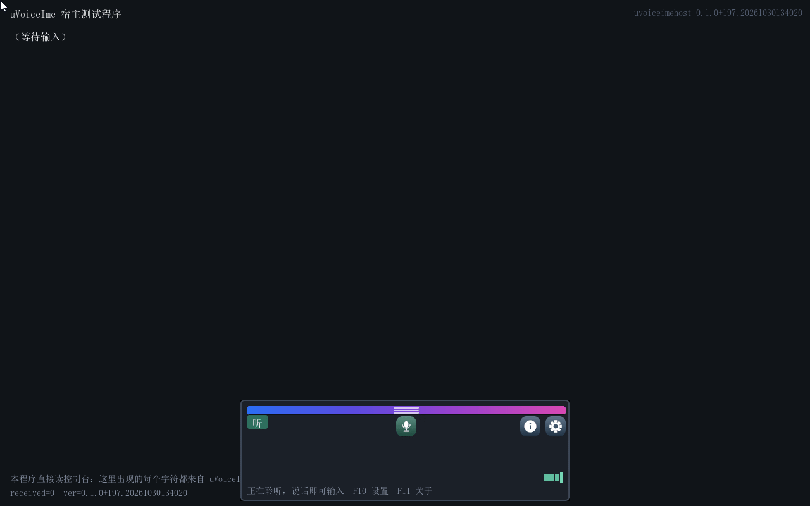
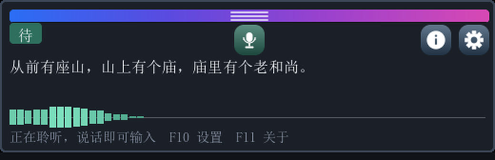
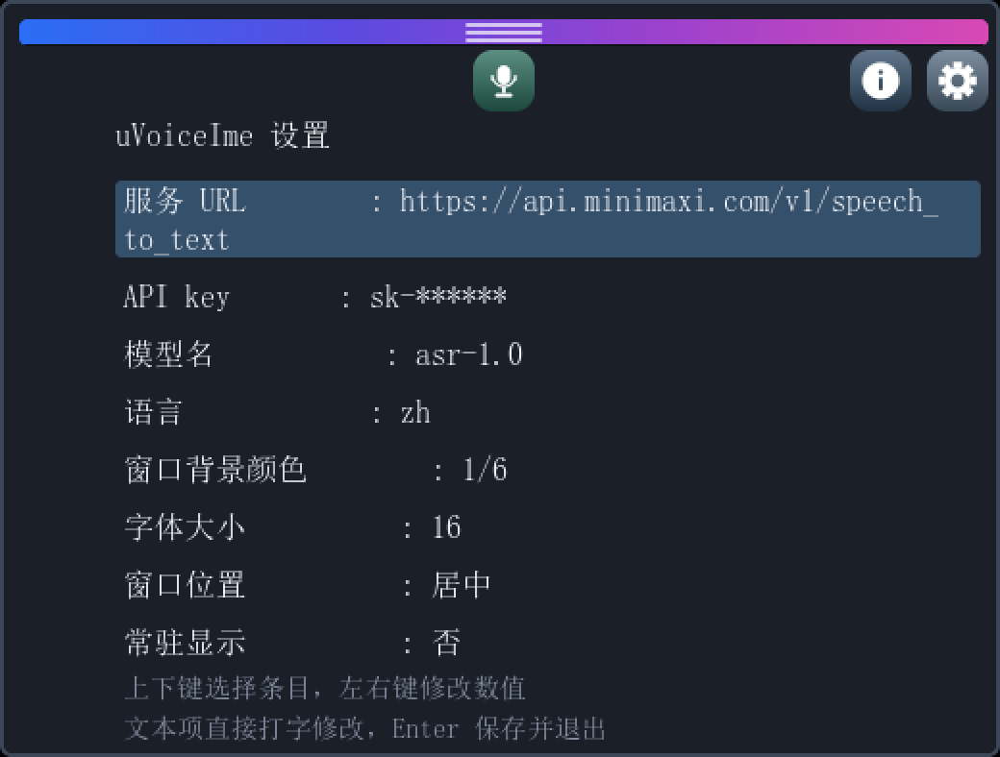
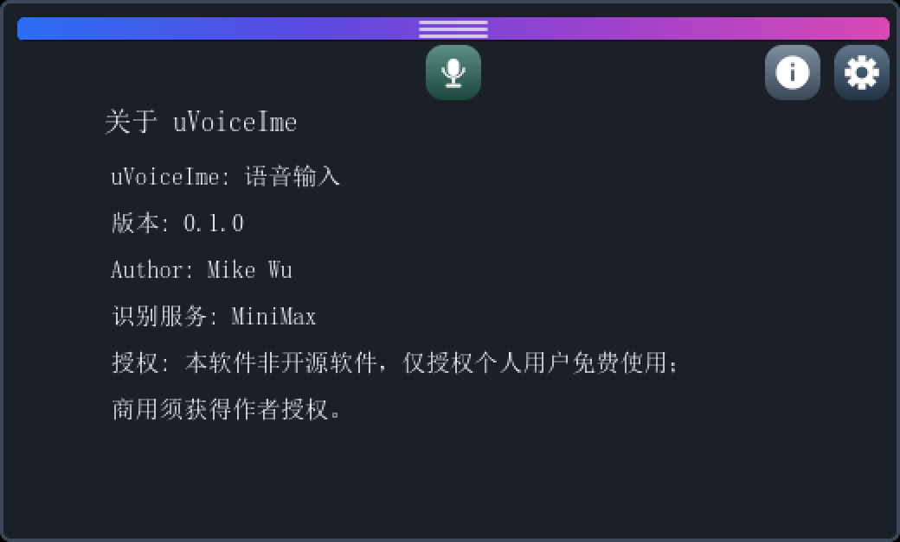
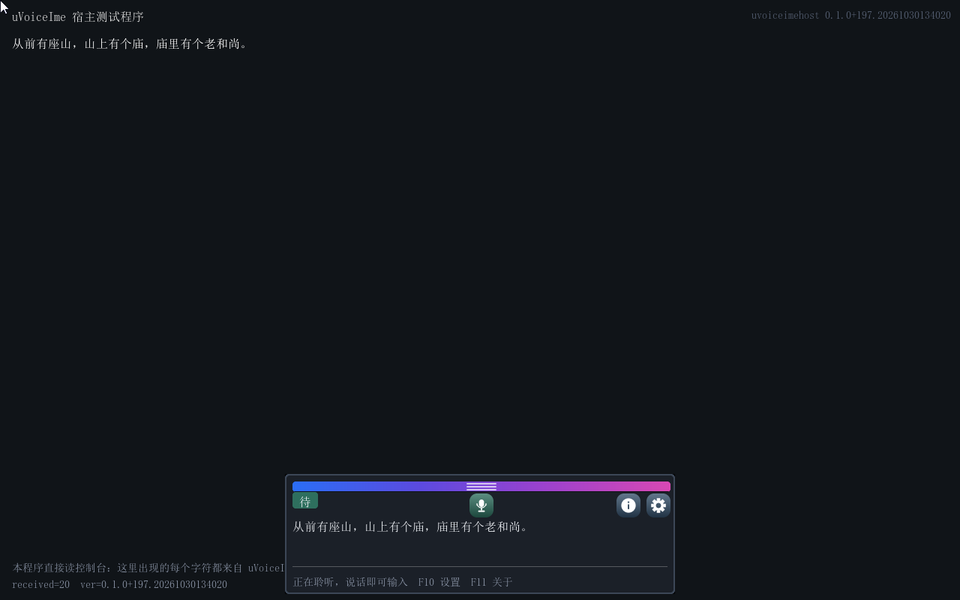

# uVoiceIme：给 UEFI Shell 用的语音输入法

> 中文 ｜ [English](#english)

**说一句话，汉字直接落进固件里的前台程序。** uVoiceIme 以常驻驱动的形式加载，接管控制台输入，把麦克风里的话送云端识别，再把结果按普通按键注入回去。**之后启动的 UEFI 程序，只要读键盘，就能直接收到中文**，宿主一行代码都不用改。

当前版本 **v0.1.0.231**（2026-10-31）·
[下载最新发布](https://github.com/MikeWuPing/uVoiceIme/releases/latest) ·
[产品手册（网页版）](docs/manual/index.html) · [Word](docs/uVoiceIme-产品手册.docx) · [PDF](docs/uVoiceIme-产品手册.pdf)



*一段完整的演示，1280×800 原始分辨率。对着麦克风说“从前有座山，”“山上有个庙，”“庙里有个老和尚。”，三句分三次落字，浮窗底部的波形跟着起伏。*

---

## 一、它要解决的问题

UEFI Shell 与绝大多数 UEFI 应用只认 ASCII：键盘送进来的是 `EFI_INPUT_KEY.UnicodeChar`，汉字根本进不来。想在固件里输入一段中文，先得有输入法。同门的 [uIME](https://github.com/MikeWuPing/uIME) 解决了这件事，它敲拼音、选字，汉字进宿主。

可还有另一半场景。固件里开始出现对话式的工具，输入的是一整句自然语言，短则十几个字，长则两三行。这时键盘成了瓶颈：一个功能键按不出一个汉字，一句“帮我看一下这台机器的内存条频率对不对”要敲几十下。语音在这里比键盘顺手得多，因为人本来就是用嘴描述问题的。

所以 uVoiceIme 做的不是“一个能录音的演示程序”，而是**一条真正可用的输入通道**：麦克风常驻采集，断句、识别、注入串成一条链，识别结果对前台来说就是一个普通按键。它与 uIME 是同一副骨架，常驻驱动、接管控制台输入层、把内容以 `UnicodeChar` 注入回去；换掉的只是输入源与引擎，uIME 是键盘加本地拼音词库，这里是麦克风加云端语音识别。两者可以并存，也可以只用其中一个。

## 二、一次识别经过哪几步

**采集。** 驱动装上之后麦克风一直在采，环形缓冲开到 8 秒。识别是阻塞的，一次往返 3 到 5 秒，这期间没人去取数据；缓冲不够大，返回时读到的是被绕圈覆盖的旧数据，识别出来就是“有山。”这种碎片。

**重采样。** 硬件给的是 48 kHz 立体声，识别要 16 kHz 单声道，转换在采集路径上完成。

**断句。** 按 20 毫秒一帧算能量，连续有声即开口，静音超过 600 毫秒收段。开段时往回倒 600 毫秒，否则起音那几个字永远落在确认点之前，实测“从前有座山”会变成“从前座山”。

**识别。** 整段音频以 multipart 发到 MiniMax 的 `asr-1.0`。调用是同步的，期间界面仍在刷新，积压的按键也会被排空并当场生效。

**注入。** 返回的 UTF-8 文本切成一个个码点，以 `UnicodeChar ≥ 0x80` 的按键塞进控制台输入队列。任何等在 `WaitForKey` 或 `ReadKeyStroke` 上的程序，收到的和敲键盘没有区别。

## 三、界面

浮窗只有 520 像素宽，三个视图共用一个窗体，按需换高度，浮在任何程序上面。



*识别视图。顶行是状态芯片、居中的麦克风按钮、右侧的关于与设置两个图标键；中间是识别结果；底部一条 60 格电平波形；最下一行提示按状态说话。*

顶部那条四色渐变是拖动条，按住可拖，松手离哪条边近就贴哪条，默认底部居中。麦克风按钮放在窗体水平中线上，因为它是这个界面唯一的主动作。


*波形每格 20 毫秒，一屏 1.2 秒。没人说话时是一条中线，开口就起伏。*

波形是判断“麦克风到底有没有收到声音”的唯一依据。识别失败的时候先看它：波形平着，问题在麦克风那头；波形跟着起伏，才轮到查识别那一侧。



*URL、API key、模型名可以就地打字修改，Enter 存盘并退出，Esc 放弃；其余五项是枚举，左右键切换。API key 显示时只露掩码。*



*作者、识别服务与授权声明。*



*浮窗与宿主同屏。宿主是随包提供的 `uvoiceimehost.efi`，它只做一件事：读控制台，把收到的字符显示出来。左下角的 `received=20` 是它收到的字符数。*

## 四、操作

用功能键而不是组合键，是因为 OVMF 的 `TerminalDxe` 永远把 `KeyShiftState` 留成 0，带修饰键的热键在 QEMU 上按不出来。uIME 也踩过同一个坑。

| 键 | 作用 |
|---|---|
| <kbd>F9</kbd> | 浮窗显示 / 隐藏 |
| <kbd>F10</kbd> | 设置页 |
| <kbd>F11</kbd> | 关于页 |
| <kbd>F12</kbd> | 麦克风开关 |

设置页与关于页是模态的：打开一个会收起另一个，Esc 关闭。设置页打开期间按键全部被吃下，不会漏给前台。

鼠标可以直接点浮窗上的按钮，也可以按住顶部渐变条拖动窗口。绝对指针和相对指针两种设备都支持。

## 五、怎么用

**在 UEFI Shell 里**（顺序是强制的，驱动必须先于任何需要语音输入的程序）：

```text
Shell> fs0:                    :: 先切换到二进制所在的卷
FS0:\> load uvoiceime.efi      :: 装上并常驻，屏幕底部随即浮出浮窗
FS0:\> uvoiceimehost.efi       :: 再启动需要输入的程序（这里用附带的宿主）
```

不能直接敲 `uvoiceime.efi` 回车。它是驱动，Shell 只派发应用镜像；驱动由 `load`、启动项或固件的 dispatcher 启动。放进 `startup.nsh` 时那一时刻还没有当前目录，必须写绝对路径：

```text
@echo -off
load fs0:\uvoiceime.efi
uvoiceimehost.efi
```

**合入 BIOS 或固件**，三种形态任选：

1. Shell 里 `load`，最省事，U 盘维护环境首选。
2. 建 `Driver####` 或 `Boot####` 启动项指向 `uvoiceime.efi`，固件按文件路径加载，连 Shell 都不需要。
3. 编进固件卷，由 DXE dispatcher 自动加载并常驻，磁盘上什么都不用放。这一条有个硬性前提：给驱动写 `[Depex]`，否则它会在 GOP 与控制台输入就绪之前被调度、装不出窗口然后被卸载。

```text
[Depex]
  gEfiGraphicsOutputProtocolGuid AND gEfiSimpleTextInProtocolGuid
```

卸载：用 `dh` 找到驱动的 image handle，再 `unload <编号>`。

## 六、配置

配置写在启动卷根目录的 `uvoiceime.cfg`，一行一个键，可用 Shell 的 `edit` 直接改：

```
url=https://api.minimaxi.com/v1/speech_to_text
api-key=
model=asr-1.0
language=zh
bg=0
font=16
placement=center
always-on=off
```

`model` 必须是 `asr-1.0`。曾经为了试验写成别的名字，识别回来的就是空串，界面上看不出任何异常。

`api-key` 以明文存在这份文件里，填好之后重启输入法生效。**这个文件只属于本机，不要外传。** 旧文件名 `voiceime.cfg` 只用来迁移 API key：盘上同时存在两份时，新文件优先，旧文件里的 key 会被读进来补空缺，搬到新文件之后就没人再读它。

## 七、下载

| 文件 | 大小 | 说明 |
|---|---|---|
| `uvoiceime.efi` | 2,188,128 B | **输入法本体，唯一的必需交付物。**常驻驱动，`load` 装它，编进固件卷的也是它 |
| `uvoiceimehost.efi` | 2,124,576 B | **宿主示例**（可选）。一个最简的读控制台程序，用来当场验证“汉字真的到了另一个程序里”。它自带中文字库，不依赖固件字体 |

- 仓库里的 `bin/` 目录：最新版的两个二进制 + `SHA256SUMS.txt`
- [Releases](https://github.com/MikeWuPing/uVoiceIme/releases) 页面：每个版本的发布包

| 文档 | 格式 |
|---|---|
| 产品手册（界面导览、操作、设置、配置、加载、排障） | [网页版](docs/manual/index.html) · [Word](docs/uVoiceIme-产品手册.docx) · [PDF](docs/uVoiceIme-产品手册.pdf) |

## 八、已知限制

**只验证过 QEMU 的 AC'97，没有在真机上跑过。** 换到 HDA 或真实声卡，采集层要重写一遍。

**依赖云端识别。** 没有网络、没有 key，就没有输出。请求一次 3 到 5 秒，这期间采集停摆，界面仍在刷新但不确认新的语音起点。

**头 1.28 秒不确认语音。** 这段时间在估计环境噪声底。加载之后立刻开口，开头那半句会被吞掉。

**采集挂在读键盘的链上。** 驱动靠前台读控制台时被调用，所以宿主帧率低到一秒几帧时，采集跟不上实时，长句会被切成小段。

**麦克风必须有信号。** 波形平着就是没信号，先查插头与物理静音开关，再怀疑软件。

**设置项只收 ASCII。** URL、API key、模型名都是 ASCII，真人用键盘不受影响。

## 九、许可

**uVoiceIme 是专有软件，不开源。** 源码不对外发布，未经作者书面许可不得复制、修改、分发或用于衍生作品。

对外发布的 `uvoiceime.efi` 二进制品**免费授权个人用户**用于个人、非商业用途；**商业用途需另行取得书面授权**（随产品 / 硬件分发或预装、作为收费服务的一部分、企业内部批量部署、有偿集成与技术支持等）。条款全文见 [`LICENSE`](LICENSE)（中英双语，以中文为准）。

语音识别走用户自备的第三方云服务，那部分的服务条款、费用与数据处理由用户与该服务商之间约定，不在本许可的范围内。

Author : Mike Wu

---

# English

**Say a sentence, and the characters land in the firmware application in front of you.** uVoiceIme loads as a resident driver, takes over console input, sends what the microphone hears to a cloud recogniser, and injects the result back as ordinary key presses. **Any UEFI application started afterwards receives Chinese simply by reading the keyboard**, with no changes to the host.

Current version **v0.1.0.231** (2026-10-31) ·
[latest release](https://github.com/MikeWuPing/uVoiceIme/releases/latest) ·
[product manual (web)](docs/manual/index.html) · [Word](docs/uVoiceIme-产品手册.docx) · [PDF](docs/uVoiceIme-产品手册.pdf)


*A complete run at the native 1280×800. Three sentences, spoken one at a time; each lands separately while the level meter under the window follows the voice.*

### Why it exists

The UEFI Shell and nearly every UEFI application speak ASCII only: a keystroke arrives as `EFI_INPUT_KEY.UnicodeChar`, and a Han character never comes. Typing Chinese in firmware needs an input method, and the sibling [uIME](https://github.com/MikeWuPing/uIME) provides one: pinyin in, characters out.

There is a second half to the story. Conversational tools now live in firmware, and what the user types is a whole sentence of natural language, a dozen characters at best and two or three lines at worst. The keyboard becomes the bottleneck: no function key produces a Han character, and "check whether the memory sticks on this machine are running at their rated speed" is dozens of keystrokes. Speech is the better instrument here, because people describe problems out loud anyway.

So this is not a program that demonstrates recording. It is an **input channel meant to be used**: the microphone is always capturing, and segmentation, recognition and injection form one chain whose result is an ordinary key press as far as the foreground program is concerned. It shares uIME's skeleton, a resident driver that owns the console input layer and injects text back as `UnicodeChar`; what changes is the source and the engine. The two can coexist, or you can use just one.

### The path of one utterance

**Capture.** Once the driver is loaded the microphone keeps capturing, with an eight-second ring buffer. Recognition blocks for three to five seconds and nobody drains the ring meanwhile; a smaller buffer means reading data already overwritten, which surfaces as a fragment instead of the sentence.

**Resampling.** The hardware delivers 48 kHz stereo; recognition wants 16 kHz mono. The conversion happens on the capture path.

**Segmentation.** Energy is measured on 20 ms frames. Speech opens a segment; 600 ms of silence closes it. On opening, 600 ms of pre-roll is prepended, otherwise the onset is lost.

**Recognition.** The segment goes to MiniMax `asr-1.0` as multipart. The call is synchronous. The window keeps repainting during it, and queued key presses are drained and take effect immediately.

**Injection.** The returned UTF-8 text is split into code points and pushed into the console input queue as `UnicodeChar ≥ 0x80` keys. Any program sitting in `WaitForKey` or `ReadKeyStroke` receives them exactly like typed keys.

### The window

The overlay is 520 pixels wide, with three views sharing one window and changing its height as needed, floating above any program.


*Recognition view. The top row holds the mode chip, the centred microphone button, and the info and gear icon keys; the middle shows the recognised text; a 60-cell level meter sits underneath; the last row is a hint line that speaks according to state.*

The four-hue gradient along the top is the grab bar. Hold it to drag, release near an edge to dock there; the default is bottom centre. The microphone button sits on the window's horizontal centreline because it is the one primary action.


*One cell per 20 ms, 1.2 seconds across. Idle, it is a flat centre line; speak and it moves.*

The meter is the only sure way to tell whether the microphone is receiving anything. When recognition fails, look there first: a flat line means the problem is at the microphone, not in the recogniser.


*URL, API key and model can be edited in place; Enter saves and exits, Esc discards. The other five are enumerations, switched with left and right. The API key is shown as a mask.*


*Author, recognition service, licence notice.*


*Window and host on one screen. The host is the bundled `uvoiceimehost.efi`, which does one thing: read the console and display what arrives. `received=20` in its corner is the character count.*

### Keys

Function keys rather than chords, because OVMF's `TerminalDxe` always leaves `KeyShiftState` at zero and modified hotkeys cannot be produced under QEMU. uIME hit the same wall.

| Key | Action |
|---|---|
| <kbd>F9</kbd> | Show / hide the window |
| <kbd>F10</kbd> | Settings |
| <kbd>F11</kbd> | About |
| <kbd>F12</kbd> | Microphone on / off |

Settings and About are modal: opening one closes the other, Esc closes. While Settings is open every key is consumed and none leaks to the host. The mouse can click the window's buttons and drag it by the gradient bar; both absolute and relative pointer devices are supported.

### How to start it

**In the UEFI Shell** (the order is mandatory, the driver must precede anything that wants voice input):

```text
Shell> fs0:                    :: switch to the volume holding the binaries
FS0:\> load uvoiceime.efi      :: install, resident - the window appears at the bottom
FS0:\> uvoiceimehost.efi       :: then start whatever needs input (here: the bundled host)
```

Typing `uvoiceime.efi` and pressing Enter does **not** work. It is a driver, and the Shell only dispatches applications; a driver is started by `load`, a boot option, or the dispatcher. In `startup.nsh` there is no current directory yet, so spell the path absolutely: `load fs0:\uvoiceime.efi`.

**Into a BIOS or firmware**, pick one of three shapes:

1. `load` it in the Shell, easiest, ideal for a USB maintenance stick.
2. A boot option (`Driver####` / `Boot####`) pointing at `uvoiceime.efi`; the firmware loads it by file path, no Shell involved.
3. Compiled into a firmware volume: the DXE dispatcher loads it and it stays resident, with nothing on disk at all. One hard prerequisite, the driver needs a `[Depex]`, or it is dispatched before GOP and console input exist, fails to create the window and gets unloaded:

```text
[Depex]
  gEfiGraphicsOutputProtocolGuid AND gEfiSimpleTextInProtocolGuid
```

To unload, find the driver's image handle with `dh` and `unload` its number.

### Configuration

Configuration lives in `uvoiceime.cfg` at the root of the boot volume, one key per line, editable with the Shell's own `edit`:

```
url=https://api.minimaxi.com/v1/speech_to_text
api-key=
model=asr-1.0
language=zh
bg=0
font=16
placement=center
always-on=off
```

`model` must be `asr-1.0`. It was once set to an experimental name and recognition returned empty strings, with nothing visibly wrong in the window.

`api-key` is stored in clear text in that file; fill it in and restart the input method. **That file belongs to this machine only; do not pass it on.** The older name `voiceime.cfg` is read once, to migrate an API key; after the key has been copied over, nothing reads it again.

### Download

| File | Size | What it is |
|---|---|---|
| `uvoiceime.efi` | 2,188,128 B | **The input method, and the only required deliverable.** A resident driver; this is what `load` starts and what goes into a firmware volume |
| `uvoiceimehost.efi` | 2,124,576 B | **Example host** (optional). A minimal console-reading program that proves characters really reach another application; it carries its own CJK font |

`bin/` in this repository holds the current binaries plus `SHA256SUMS.txt`;
[Releases](https://github.com/MikeWuPing/uVoiceIme/releases) holds every published version.

| Documentation | Formats |
|---|---|
| Product manual (window tour, keys, settings, configuration, loading, troubleshooting) | [web](docs/manual/index.html) · [Word](docs/uVoiceIme-产品手册.docx) · [PDF](docs/uVoiceIme-产品手册.pdf) |

### Known limits

**Only QEMU's AC'97 has been verified; it has never run on real hardware.** Moving to HDA or a real codec means rewriting the capture layer.

**Recognition is in the cloud.** No network or no key means no output. A request takes three to five seconds, during which capture is stalled.

**The first 1.28 seconds confirm nothing.** That window estimates the noise floor. Speak immediately after loading and the opening words are swallowed.

**Capture hangs off the keyboard-read chain.** The driver is called while the foreground program reads the console, so a host repainting at a few frames per second cannot feed audio faster than real time and long sentences arrive in pieces.

**The microphone must produce a signal.** A flat meter means no signal: check the plug and the hardware mute switch before suspecting software.

**Settings accept ASCII only.** URL, API key and model are ASCII, which costs a human keyboard user nothing.

### Licence

**uVoiceIme is proprietary and not open source.** The source is not published; it may not be copied, modified, distributed or used to create derivative works without the author's written permission.

The published `uvoiceime.efi` binary is **free for individual users** for personal, non-commercial use; **commercial use requires a separate written licence** (shipping or pre-installing it with a product or hardware, offering it as part of a paid service, deploying it across an organisation, or paid integration and support). Full terms in [`LICENSE`](LICENSE) (bilingual; the Chinese text prevails).

Speech recognition runs on a third-party cloud service that the user brings an account for; its terms, billing and data handling are between the user and that provider, and are outside this licence.

Author : Mike Wu
